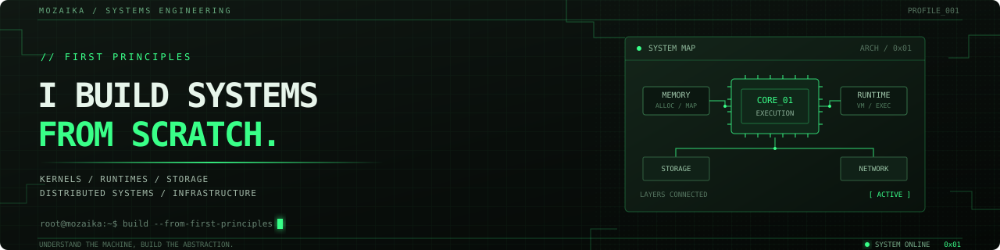

 

  

  
  
  

  <code>systems programming</code> ·
  <code>AI infrastructure</code> ·
  <code>programming languages</code> ·
  <code>computer architecture</code> ·
  <code>distributed systems</code>

---

## `01 / ABOUT`

I'm a CS student from Kazakhstan interested in building software that goes beyond the surface.

My interests span systems engineering, artificial intelligence, programming language design, computer architecture, backend infrastructure, and high-performance computing.

I learn by building real projects, understanding their internal mechanisms, and turning technical ideas into working software.

I believe the best way to understand a system is to build one.

---

## `02 / SELECTED PROJECTS`

  
  
  

### AI & Intelligent Systems

| Project | What it is | Technologies |
|:--|:--|:--|
| [**Hephaestus**](https://github.com/mozaika228/hephaestus) | Multi-platform AI assistant with chat, file analysis, planning, integrations, and multi-agent orchestration | `TypeScript` · `Python` · `C++` · `Flutter` |
| [**AgroAgent**](https://github.com/mozaika228/agroagent) | AI-agent platform for agriculture in West Kazakhstan, featuring hierarchical agents and hybrid RAG | `Python` · `LangGraph` · `FastAPI` · `Next.js` |
| [**OmniSight**](https://github.com/mozaika228/omnisight) | AI-powered video understanding platform with object detection, speech recognition, and semantic search | `Python` · `YOLO` · `Whisper` · `CLIP` |

### Software Engineering & Computer Architecture

| Project | What it is | Technologies |
|:--|:--|:--|
| [**Danilium**](https://github.com/mozaika228/danilium) | General-purpose programming language with a custom lexer, parser, AST, type checker, and interpreter | `Python` |
| [**SimpleComputer**](https://github.com/mozaika228/simplecomputer) | Three-level computer architecture model with a high-level language, assembler, and machine-code emulator | `C` |
| [**TasqueManager**](https://github.com/mozaika228/tasquemanager) | Fullstack task management system with JWT authentication, Kanban, notifications, and observability | `Java` · `Spring Boot` · `React` |

  

---

## `03 / TOOLKIT`

  <strong>Systems & Low-Level</strong> 
  
  
  
  
  

  <strong>Backend & Application Development</strong> 
  
  
  
  
  
  
  

  <strong>AI & Machine Learning</strong> 
  
  
  
  

  <strong>Infrastructure & Data</strong> 
  
  
  
  
  

---

## `04 / CURRENT FOCUS`

- **AI Engineering:** multi-agent orchestration, RAG pipelines, model integration, and intelligent applications.
- **Programming Languages:** lexer/parser design, type systems, interpreters, bytecode, and virtual machines.
- **Computer Architecture:** CPU instructions, memory models, assembly, and emulation.
- **Backend Engineering:** distributed services, authentication, databases, and API architecture.
- **Infrastructure:** observability, monitoring, reliability, and deployment.

I focus on understanding the mechanisms, implementing core components, and validating their behavior through testing and experimentation.

---

## `05 / HOW I WORK`

I approach engineering through first principles: understand the problem, design the architecture, implement the solution, and validate the result.

- **First principles:** understand the mechanisms behind abstractions.
- **Architecture:** design systems with clear responsibilities and boundaries.
- **Correctness:** consider edge cases, failures, security, and reliability.
- **Performance:** measure bottlenecks before optimizing.
- **Iteration:** build, test, inspect, and improve.

  
  →
  
  →
  
  →
  

---

  <strong>Build from first principles.</strong> 
  <em>Curious? Open a repository. The code does the talking.</em>  
  

