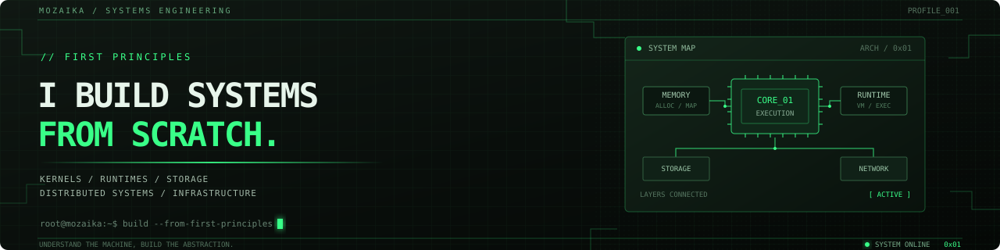

  

  
  
  

  <code>systems programming</code> ·
  <code>runtimes</code> ·
  <code>kernels</code> ·
  <code>databases</code> ·
  <code>distributed systems</code>

---

## `01 / ABOUT`

I'm a CS student from Kazakhstan interested in how software works **under the hood**: from CPU instructions and memory management to runtimes, storage engines, distributed systems, and AI infrastructure.

I learn by building the underlying systems myself, then testing and refining them from first principles.

---

## `02 / SELECTED PROJECTS`

  
  
  

| Project | What it is | Technologies |
|:--|:--|:--|
| [**PulseEngine**](https://github.com/mozaika228/pulseengine) | Low-latency HFT order matching engine with an optimized hot path | `Java` · `C++` |
| [**BareCore**](https://github.com/mozaika228/barecore) | Minimal x86_64 OS, from bootloader and kernel to userspace | `C` · `Assembly` |
| [**TinyDatabase**](https://github.com/mozaika228/tinydatabase) | Rust storage engine with WAL, MVCC, and LSM-based persistence | `Rust` |
| [**DotForge**](https://github.com/mozaika228/dotforge) | CLR-style runtime experiments with garbage collection and JIT infrastructure | `.NET` |
| [**KernelPulse**](https://github.com/mozaika228/kernelpulse) | Kernel monitoring and eBPF-based observability tools | `Linux` · `eBPF` |
| [**SteelFlow**](https://github.com/mozaika228/steelflow) | Self-hosted ML inference and autonomous-agent infrastructure | `Python` · `C++` |

  

---

## `03 / TOOLKIT`

  <strong>Systems & low-level</strong> 
  
  
  
  
  

  <strong>Infrastructure</strong> 
  
  
  

  <strong>AI systems</strong> 
  
  
  

---

## `04 / CURRENT FOCUS`

- Runtime and VM architecture, garbage collection, and JIT compilation
- Database internals, storage correctness, and crash recovery
- Kernel observability with eBPF
- Distributed synchronization and high-performance computing
- Autonomous AI infrastructure

I focus on understanding the mechanisms, implementing core components, and validating their behavior through testing and experimentation.

---

## `05 / HOW I WORK`

I start with **how a system works**, then build a small, working version to make the design concrete.

- **First principles:** understand the mechanism behind the abstraction.
- **Correctness:** reason about invariants, edge cases, failures, and recovery.
- **Performance:** measure bottlenecks before optimizing.
- **Iteration:** build, test, inspect, and refine.

  
  →
  
  →
  
  →
  

---

  <strong>Build from first principles.</strong> 
  <em>Curious? Open a repository. The code does the talking.</em>  
  

